# Cookie D'oh!

### *Accept all Cookies*

A silly arcade game in the style of the C64 / Amiga / early-286 era (think *Tapper* meets
*Egg*, dressed like *Night Shift*). Built on [game-toolkit](https://github.com/sunsided/game-toolkit).

It's the night shift at the Internet. Websites hang off the mainframe and spit cookies onto
four conveyor belts. You ride the lift at the end of the line with a jar, and **every cookie
must be accepted**. Drop one and it crumbles on the floor: *"D'oh!"* (with a sad trombone).

- **Up / Down** (W/S, J/K, 1-4, D-pad, or tap a belt): ride the lift.
- A cookie tipping off the belt drops onto the end of the belt below and smashes there -
  unless you're parked exactly one lane down: that dive-save pays double.
- **Space** (Enter, pad A): *Accept all* - dismisses the cookie-consent popups that cover
  the belts from level 2 on.
- **The Web Crawler** drops down to the jar spot of a random lane (watch for the red `!`).
  Don't be standing there when it lands. Cookies arriving at its lane get eaten - no penalty.
- **The Cache Cleaner** patrols the floor clearing crumbs. Now and then it beeps and heads for
  the dock under the lift (red `!` on the bottom lane) and bumps whoever is parked there.
  Camp at the bottom and it comes three times as often. While docked, it clears cookies
  that drop off the bottom belt - no penalty.
- **Golden cookies** are worth 10x. Ten cookies fill the jar for a bonus.
- Three D'ohs and your session expires.
- **P** / Esc pause; **Esc** again while paused quits to the title (Esc on the title quits
  the game). **G** cycle graphics modes, **M** mute, **C** toggle scanlines.

## Silly extras

- **Cracktro:** start with `cargo run -- --cracktro`, or open the web build with
  `?cracktro`. *Cookies & Crackers* proudly present... with copper bars, a parallax
  starfield, a wobbling logo, cookie bobs and a sine scroller. Space skips (in the browser
  the first key press only switches the sound on).
- **Graphics modes:** press **G** in-game, or start with `--gfx=ega` / `?gfx=ega`. Every
  frame is reduced to real hardware palettes with ordered dithering:

  | Mode | Looks like |
  |------|-----------|
  | `vga` | the game as drawn (default) |
  | `ega` | IBM EGA, 16 fixed colors |
  | `c64` | Commodore 64 multicolor: 16 colors, double-wide pixels, hi-res status bar |
  | `cga` | IBM CGA palette 1: black, cyan, magenta, white. Sorry. |
  | `hercules` | 1-bit amber monochrome |

  Options combine: `?cracktro&gfx=c64`.

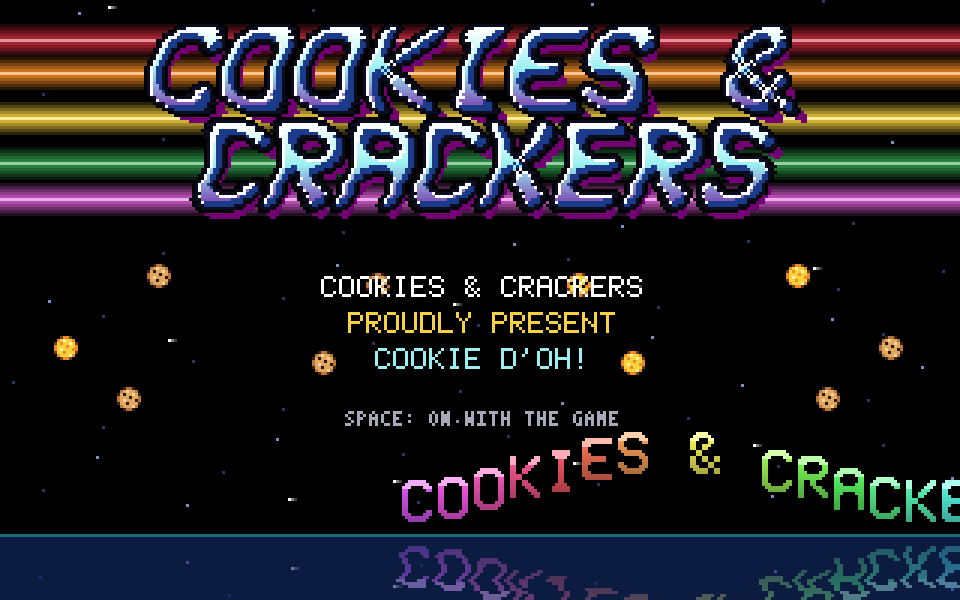

| | |
|---|---|
| 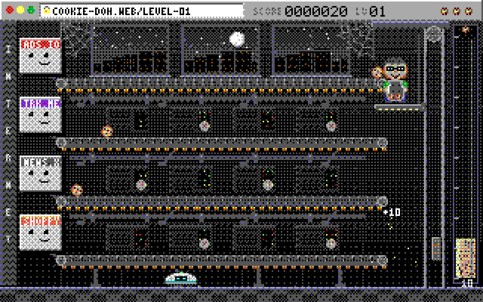 | 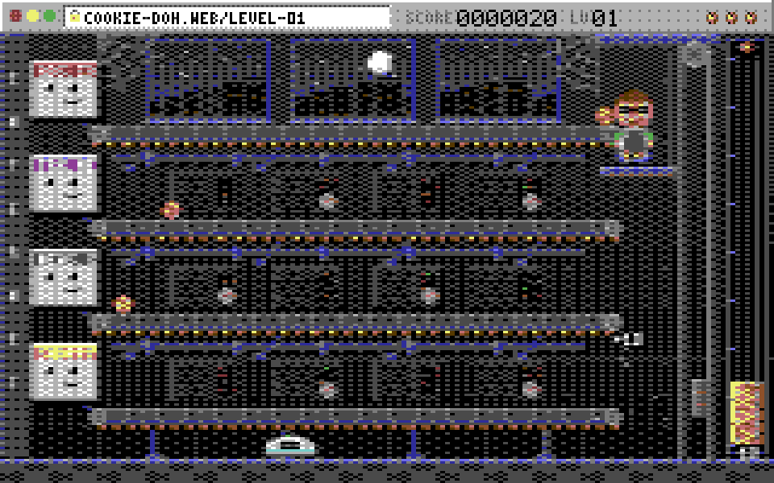 |
| 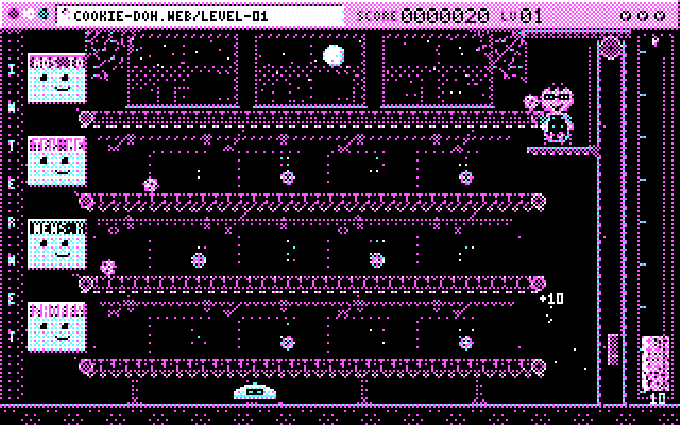 | 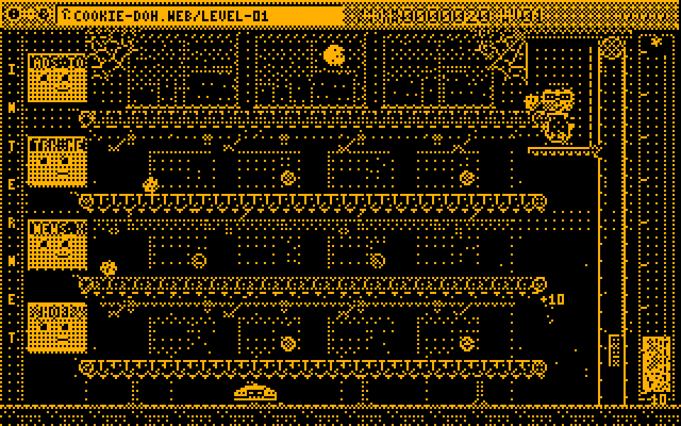 |

Shortcuts: `task run:cracked` (alias `intro`), `task run:ega` / `run:c64` / `run:cga` /
`run:hercules`, `task run:retro` (cracktro, then C64), or `task run GFX=cga`.

## Screenshots

| | |
|---|---|
| 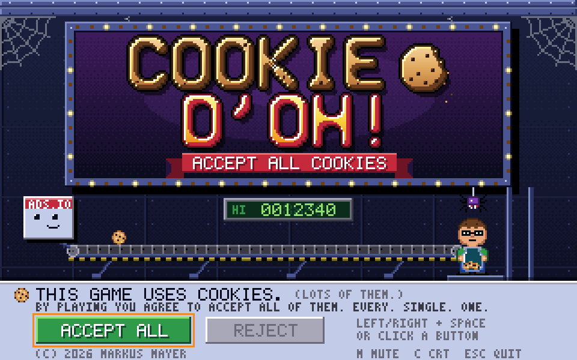 | 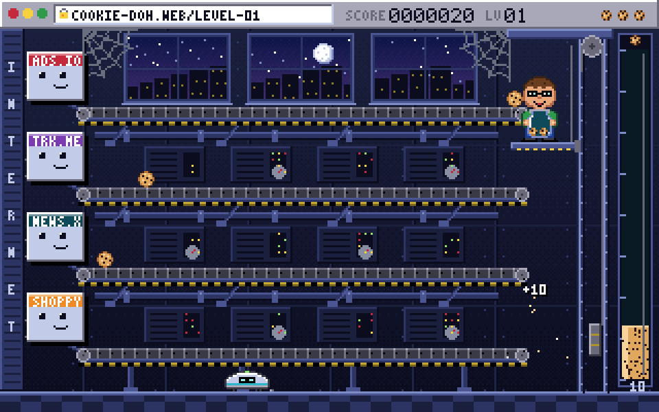 |
| 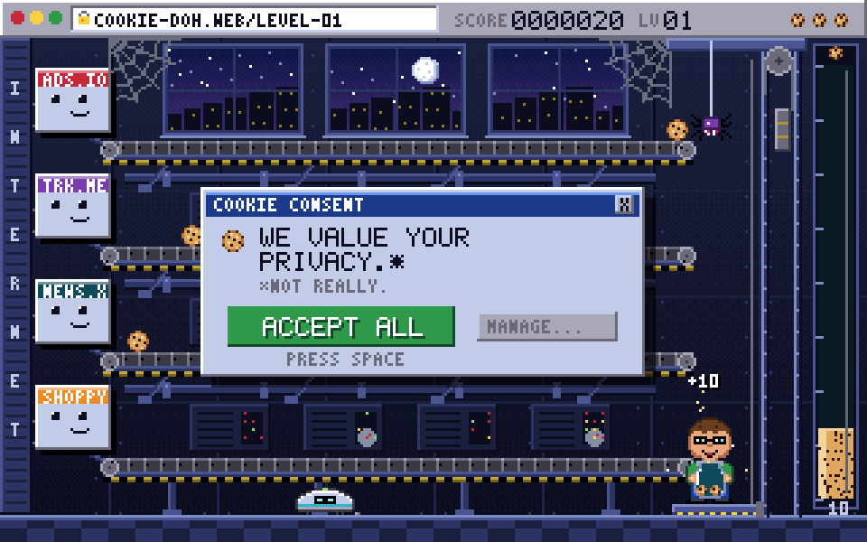 | 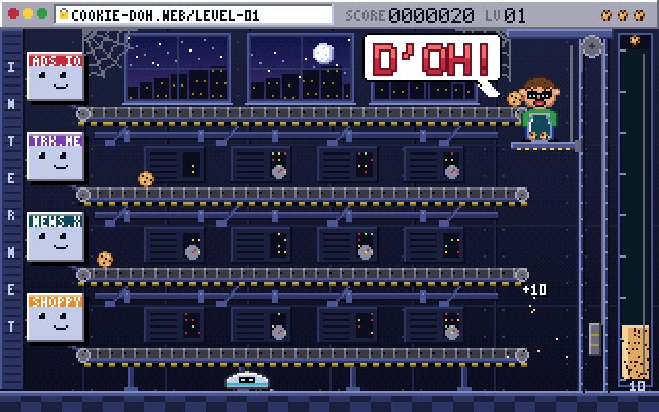 |
| 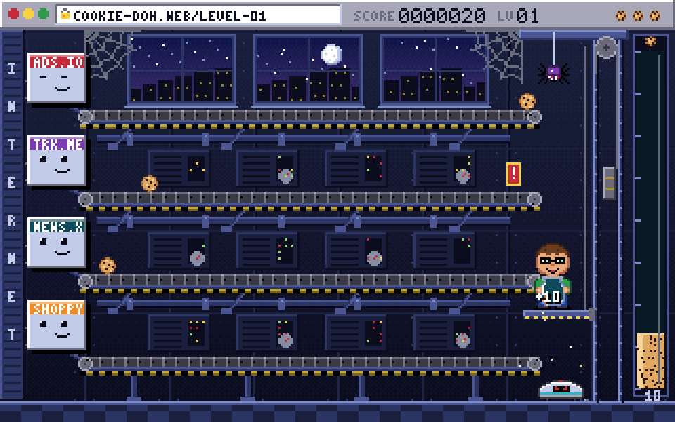 | 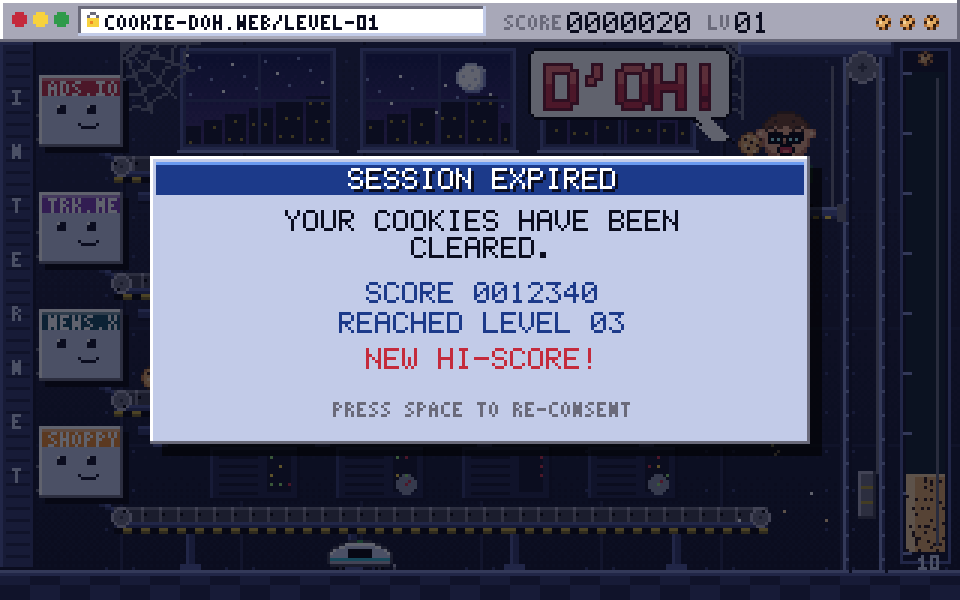 |

## Run

```sh
cargo run                  # or: task run
```

## Run in the browser

```sh
task setup                       # wasm target + trunk
task web                         # http://localhost:8080, rebuilds on save
PROFILE=release task web:build   # dist/ - zip it for itch.io
```

Sound starts after the first key press or click (browser rule).

## How it's made

There are no asset files. Everything is drawn and synthesized in code:

- **Graphics** render into a 320x200 CPU framebuffer that is uploaded as one texture and
  scaled by whole pixels (plus optional scanlines). Sprites are ASCII art in
  `src/render/art.rs` against a shared ~40-color palette (`src/gfx/palette.rs`); fonts are
  hand-made 5x7 and 3x5 bitmaps.
- **Music** is a tiny 4-channel tracker (pulse / pulse / triangle / noise drums) playing
  songs written in text notation (`src/sound/songs.rs`) on the audio thread.
- **"D'oh!"** is a formant synthesizer (`src/sound/voice.rs`): a glottal pulse through
  three cascaded resonators gliding from "d" to "oh", crushed to 6 bits at 8 kHz.

`task snapshot` renders screenshots of every screen and WAVs of the audio into
`snapshots/` without opening a window.

## Layout

```
src/logic/      the rules, pure and unit-tested (tuning.rs holds every difficulty knob)
src/gfx/        framebuffer, palette, fonts, sprite parser, a tiny PNG encoder
src/render/     scene, sprites, effects, title and game-over screens
src/sound/      synth, tracker, songs, SFX, the voice
src/app.rs      game-toolkit glue: input, audio device, presenting the framebuffer
src/platform.rs hi-score storage (file natively, localStorage on the web)
examples/       snapshot: headless screenshots + WAV export
```
